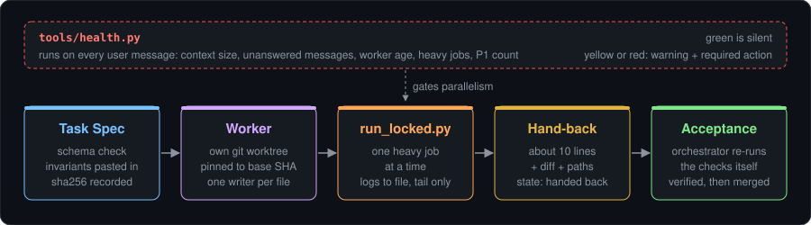
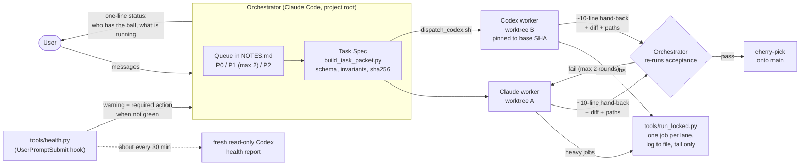
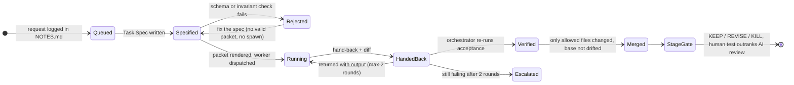
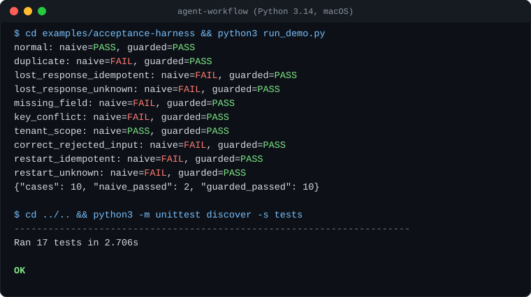

# agent-workflow

**A 144-minute multi-agent session stalled. This is the measurement of why, and the job lock, health check and acceptance gates that fixed it.**

Python stdlib only · 24 tests · 4 decision records with numbers

[](https://www.python.org/)
[](tools/dispatch_codex.sh)
[](https://docs.anthropic.com/en/docs/claude-code)
[](https://github.com/openai/codex)
[](LICENSE)
[](tests/)

<p align="center">
  
</p>

The orchestrator decides what to do. The gates decide when work counts as done.

> **Read the write-up:** [How I run Claude and Codex in parallel with verification gates](ARTICLE.md) ([繁體中文](ARTICLE_zh-TW.md)). It covers the session that stalled, the numbers from its logs, and why each rule here exists.

## Why this exists

This was extracted from two personal projects in October 2026: a Blender-rendered interactive short film for the web and a roguelite game prototype. The first long session (144 minutes, one orchestrator, 10 sub-agents) stalled. The transcripts showed why:

| Measured in the stalled session | Value |
|---|---|
| Orchestrator context growth, no compaction | 86k to 552k tokens |
| Blender terminal output returned through tool calls | about 564,000 characters |
| Blender runs in the orchestrator's own foreground | 71 |
| User messages queued behind running tools | 34 |
| Worst single model turn | 395 seconds |
| Peak concurrency | 7 agents, 5 Blender processes |
| Agent start failures | 0 of 10 (startup was not the problem) |

The cause was not the number of agents. It was one session acting as chat window, dispatcher and render farm at once, with heavy output flowing into its context. The fixes are ordinary engineering: isolate each worker, serialize heavy jobs, keep logs on disk, measure the coordinator from the outside, validate prompts as contracts, and treat "handed back", "verified" and "merged" as three separate states.

These are the same failure modes as any job system: unbounded output in the request path, no backpressure, and "200 OK" mistaken for "done". The fixes are the ones I would apply to a production queue.

After the fixes, the health check logged 129 measurements over two days (78 green, 20 yellow, 31 red), and the first manual compaction went from 553,549 to 10,321 tokens in 77 seconds. No speed-up is claimed; the decision records say what is measured and what is still unverified.

## How it fits together

### Orchestrator, workers and worktrees



A worker may start only if it runs heavy jobs through the lock, its write scope does not overlap any other worker's, and its hand-back fits in about ten lines. There is no fixed worker cap; slowing down is decided by the health numbers.

### Task lifecycle and stage gates



"Handed back", "verified" and "merged" are tracked separately on purpose: most bad surprises in the original sessions came from treating one as another. The stage gates (prototype first, kill criteria written before results, evidence labels, human validation status) are in [playbook/STAGE_GATES.md](playbook/STAGE_GATES.md).

## Components

| Component | Purpose |
|---|---|
| [`tools/run_locked.py`](tools/run_locked.py) | Runs a command under a repo-wide file lock shared by every worktree; writes output to a log and prints only the exit code, log path and tail. |
| [`tools/health.py`](tools/health.py) | Measures the orchestrator from its transcript and the process table (context, unanswered messages, reply times, worker age, Codex and heavy jobs, P1 count). |
| [`tools/health-review-prompt.md`](tools/health-review-prompt.md) | Fixed prompt for the periodic independent Codex health report; the orchestrator may not edit it. |
| [`tools/dispatch_codex.sh`](tools/dispatch_codex.sh) | Starts one Codex worker in its own git worktree on `task/<id>`, verified to be at the current HEAD; warns about uncommitted changes the worker cannot see. |
| [`tools/hooks/claude-settings.example.json`](tools/hooks/claude-settings.example.json) | Claude Code hook config that runs `health.py --hook` on every user message. |
| [`contracts/task_spec.py`](contracts/task_spec.py) | Standard-library JSON Schema validator for Task Specs; fails on unsupported keywords instead of ignoring them. |
| [`contracts/build_task_packet.py`](contracts/build_task_packet.py) | Renders a validated spec into the exact worker prompt, injects owner invariants and tier concerns, records the prompt's sha256. |
| [`contracts/audit_task_specs.py`](contracts/audit_task_specs.py) | Lints every spec in a folder and reports concerns the builder will inject. |
| [`contracts/codex_exec_adapter.py`](contracts/codex_exec_adapter.py) | Runs a packet through `codex exec` without overriding the user's sandbox, approval or model settings; keeps all output. |
| [`contracts/schema/`](contracts/schema/), [`contracts/templates/`](contracts/templates/) | Task Spec schema, example tier S and tier B specs, the markdown task brief. |
| [`playbook/ORCHESTRATOR_RULES.md`](playbook/ORCHESTRATOR_RULES.md) | Drop-in `CLAUDE.md` / `AGENTS.md` for the coordinating session. |
| [`playbook/DISPATCH.md`](playbook/DISPATCH.md) | Dispatch, hand-back, wrap-up, health check and two-track review procedures. |
| [`playbook/PROMPT_CONTRACT.md`](playbook/PROMPT_CONTRACT.md) | Tiers, independence modes, Claude vs Codex routing. |
| [`playbook/STAGE_GATES.md`](playbook/STAGE_GATES.md) | Prototype-first gates, evidence labels, human validation rules. |
| [`decisions/`](decisions/) | Decision records: what broke, the numbers, the fix, and whether it is verified. |
| [`examples/acceptance-harness/`](examples/acceptance-harness/) | Offline demo of checking business outcomes instead of API status codes. |

## Example: check the outcome, not the status code

The acceptance harness runs a deliberately unprotected worker and a guarded worker (input validation, a SQLite intent/receipt journal, tenant-scoped idempotency keys, bounded retries) against ten hand-written failure cases. Captured from a real run:

<p align="center">
  
</p>

<details>
<summary>Same output as text</summary>

```console
$ cd examples/acceptance-harness && python3 run_demo.py
normal: naive=PASS, guarded=PASS
duplicate: naive=FAIL, guarded=PASS
lost_response_idempotent: naive=FAIL, guarded=PASS
lost_response_unknown: naive=FAIL, guarded=PASS
missing_field: naive=FAIL, guarded=PASS
key_conflict: naive=FAIL, guarded=PASS
tenant_scope: naive=PASS, guarded=PASS
correct_rejected_input: naive=FAIL, guarded=PASS
restart_idempotent: naive=FAIL, guarded=PASS
restart_unknown: naive=FAIL, guarded=PASS
{"cases": 10, "naive_passed": 2, "guarded_passed": 10}

$ cd ../.. && python3 -m unittest discover -s tests
----------------------------------------------------------------------
Ran 17 tests in 2.706s

OK
```

</details>

The baseline is weak on purpose, and ten passing cases mean only that those ten pre-written outcomes hold. See the [harness README](examples/acceptance-harness/README.md) for its limits.

`run_locked.py` keeps a 500-line job out of the caller's context:

```console
$ python3 tools/run_locked.py --lane render -- sh -c 'for i in $(seq 1 500); do echo "frame $i rendered"; done'
[run] queued for lane 'render'
[run] acquired after 0.00s
[run] log=.../tasks/run-logs/20261026-194849-24813.log lines=500
[run] last 20 lines:
frame 481 rendered
...
frame 500 rendered
[run] exit=0; total=0.03s
```

## Quickstart

Requirements: Python 3.10+ (standard library only) and bash. The `claude` and `codex` CLIs are needed only for the parts that call them.

```sh
# 1. Rules for the orchestrator
cp playbook/ORCHESTRATOR_RULES.md  your-project/CLAUDE.md
cp -r tools contracts              your-project/

# 2. Health check on every user message
cp tools/hooks/claude-settings.example.json your-project/.claude/settings.json

# 3. Serialize heavy jobs from any worktree
python3 tools/run_locked.py --lane render -- blender -b scene.blend -P render.py

# 4. A contract-checked prompt for an important task
cp contracts/concerns.example.json   contracts/concerns.json     # edit for your project
cp contracts/invariants.example.md   contracts/invariants.md     # edit for your project
python3 contracts/audit_task_specs.py contracts/templates/*.json
python3 contracts/build_task_packet.py contracts/templates/spec-tier-S-verify.json \
        tasks/prompts/verify.md --registry tasks/prompts/REGISTRY.jsonl

# 5. A Codex worker in its own worktree (run in the background, wait for exit)
$EDITOR tasks/fix-x.md                 # from contracts/templates/task-brief.md
tools/dispatch_codex.sh fix-x

# Tests
python3 -m unittest discover -s tests -v                       # 17 tests
(cd examples/acceptance-harness && python3 -m unittest -v)    # 7 more for the harness
```

## The rules in one screen

1. The orchestrator answers first and only controls. Heavy work runs in the background.
2. New requests go into a queue as P0 / P1 / P2. At most two P1 at a time.
3. One status file, one writer. Overwrite state; never append "done" under "running".
4. No fixed worker cap. A worker may start if it does not run a heavy job outside the lock, its files do not overlap anyone else's, and its hand-back fits in about 10 lines.
5. "Handed back" is not "verified" is not "merged". The orchestrator re-runs acceptance itself.
6. Structure is decided on a cheap draft; only sections the user locks go to the expensive version.
7. Two automatic retries per failure, then report with evidence.
8. An AI review is not a human test. Nothing is called fun, intuitive or wanted without one.
9. Every workflow change gets a decision record with the numbers behind it.

## Repository structure

```
agent-workflow/
├── ARTICLE.md, ARTICLE_zh-TW.md   the write-up (English, Traditional Chinese)
├── playbook/                      rules and procedures for the orchestrator
├── tools/                         run_locked.py, health.py, dispatch_codex.sh, hooks/
├── contracts/                     Task Spec schema, validator, packet builder, Codex adapter
├── decisions/                     decision records with the numbers behind each rule
├── examples/acceptance-harness/   offline outcome-checking demo with its own 7 tests
├── tests/                         17 tests for the lock, the contracts and the health check
└── docs/assets/                   README images
```

## What it does not do

- It does not make the orchestrator preemptible. The health hook only fires when the user sends a message, so during a long model turn the warning is late too.
- Most rules are enforced by convention, not code. Code enforces the job lock, log truncation, spec validation, worktree pinning and the measurements.
- It does not claim a speed-up. The decision records list what was measured and what is still unverified.
- Game assets, renders and project-specific content from the original projects are not included.

## License

MIT. See [LICENSE](LICENSE).
